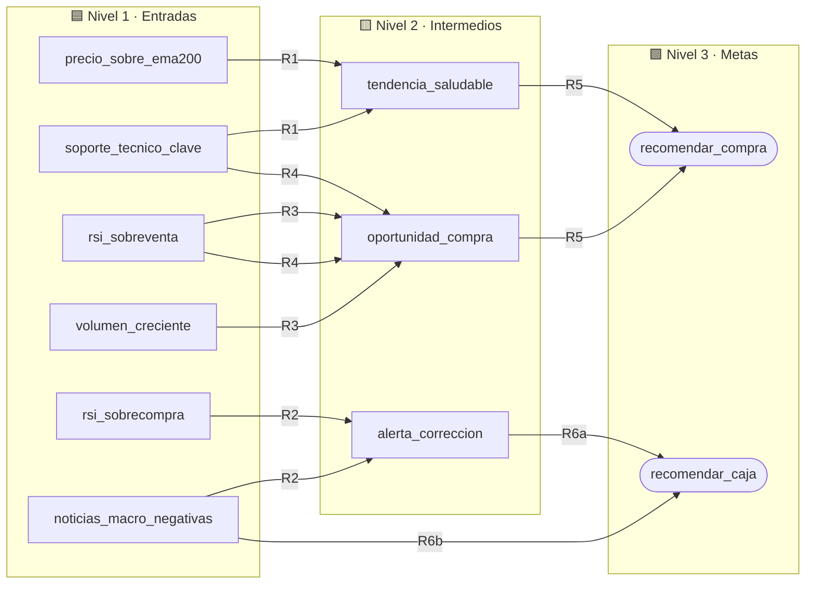

<div align="center">

# 📈 CryptoRisk & Trend SBC

### Sistema Basado en Conocimiento para la evaluación de riesgo y decisiones de *swing trading* en criptomonedas


*Cláusulas de Horn · Encadenamiento hacia adelante y hacia atrás · Explicabilidad · `YES` / `NO` / `UNKNOWN`*

</div>

---

## 📚 Tabla de contenido

1. [Descripción general](#-descripción-general)
2. [Dominio y justificación](#-dominio-y-justificación)
3. [Arquitectura del conocimiento](#-arquitectura-del-conocimiento)
4. [Base de conocimiento](#-base-de-conocimiento)
5. [Lógica trivalente e incertidumbre](#-lógica-trivalente-e-incertidumbre)
6. [Motor de inferencia y API](#-motor-de-inferencia-y-api)
7. [Escenarios de prueba](#-escenarios-de-prueba)
8. [Explicabilidad](#-explicabilidad)
9. [Cumplimiento de los requisitos](#-cumplimiento-de-los-requisitos)
10. [Estructura del repositorio](#-estructura-del-repositorio)
11. [Cómo ejecutarlo](#-cómo-ejecutarlo)
12. [Hoja de ruta de desarrollo](#-hoja-de-ruta-de-desarrollo)
13. [Limitaciones y trabajo futuro](#-limitaciones-y-trabajo-futuro)
14. [Aviso legal](#-aviso-legal)

---

## 🎯 Descripción general

**CryptoRisk & Trend SBC** apoya decisiones de inversión en **criptomonedas** bajo la estrategia de *swing trading*. A partir de datos de mercado (tendencia, RSI, volumen, soportes y noticias macro) razona con **reglas lógicas** hasta una de dos recomendaciones:

| Recomendación | Significado |
| :--- | :--- |
| 🟢 `recomendar_compra` | Abrir posición de compra (riesgo moderado/bajo) |
| 🔴 `recomendar_caja` | Mantener liquidez y evitar operar (alto riesgo) |

Se construye sobre el motor del **Laboratorio 05** (`TValue`, `TAtom`, `TRule`, `TKnowledgeBase`, `TFactBase`, `forward`, `backward`, `explain`, `why`) y demuestra: ⏩ forward chaining, ⏪ backward chaining interactivo y 🔍 explicabilidad.

---

## 🧭 Dominio y justificación

El análisis técnico opera con marcos **basados en reglas** que combinan tendencia, impulso (RSI) y contexto macro, lo que lo hace idóneo para un SBC con cláusulas de Horn:

- 🧱 **Jerarquía natural:** datos de mercado → estados intermedios → recomendación.
- ❓ **Incertidumbre:** un indicador puede no estar disponible; `UNKNOWN` permite rutas alternativas (R4) o preguntar al usuario solo lo necesario.
- 🪟 **Transparencia:** cada conclusión es trazable hasta los hechos que la originaron.
- ✅ **Viabilidad:** 11 proposiciones y 7 reglas son abarcables, verificables por un experto y ejecutables en el motor del laboratorio.

---

## 🏗️ Arquitectura del conocimiento



---

## 🧠 Base de conocimiento

### Proposiciones atómicas (`TAtom`)

| `symbol` | `meaning` | Nivel |
| :--- | :--- | :---: |
| `precio_sobre_ema200` | El precio está por encima de la media móvil de 200 periodos | 1️⃣ |
| `rsi_sobreventa` | El RSI está por debajo de 30 | 1️⃣ |
| `rsi_sobrecompra` | El RSI está por encima de 70 | 1️⃣ |
| `volumen_creciente` | El volumen de las últimas sesiones va en aumento | 1️⃣ |
| `soporte_tecnico_clave` | El precio rebotó en un soporte histórico importante | 1️⃣ |
| `noticias_macro_negativas` | Hay reportes macro o regulatorios adversos | 1️⃣ |
| `tendencia_saludable` | El mercado mantiene una estructura de precios favorable | 2️⃣ |
| `alerta_correccion` | Hay indicios técnicos de que el activo puede retroceder | 2️⃣ |
| `oportunidad_compra` | Las condiciones sugieren un buen punto de entrada | 2️⃣ |
| `recomendar_compra` | Abrir posición de compra (riesgo moderado/bajo) | 3️⃣ |
| `recomendar_caja` | Mantener liquidez / evitar operar (alto riesgo) | 3️⃣ |

### Reglas (`TRule`)

| Regla | Antecedentes | | Consecuente | Nota |
| :---: | :--- | :---: | :--- | :--- |
| **R1** | `precio_sobre_ema200 ∧ soporte_tecnico_clave` | ⇒ | `tendencia_saludable` | |
| **R2** | `rsi_sobrecompra ∧ noticias_macro_negativas` | ⇒ | `alerta_correccion` | |
| **R3** | `rsi_sobreventa ∧ volumen_creciente` | ⇒ | `oportunidad_compra` | 🥇 vía primaria |
| **R4** | `rsi_sobreventa ∧ soporte_tecnico_clave` | ⇒ | `oportunidad_compra` | 🥈 respaldo si el volumen es `UNKNOWN` |
| **R5** | `tendencia_saludable ∧ oportunidad_compra` | ⇒ | `recomendar_compra` | |
| **R6a** | `alerta_correccion` | ⇒ | `recomendar_caja` | |
| **R6b** | `noticias_macro_negativas` | ⇒ | `recomendar_caja` | |

> 💡 **Sobre R6:** una cláusula de Horn tiene un único literal positivo y no admite disyunciones en el antecedente; `alerta_correccion ∨ noticias_macro_negativas ⇒ recomendar_caja` se modela como dos reglas (R6a y R6b).

---

## ❓ Lógica trivalente e incertidumbre

| Valor | `TValue` | Significado |
| :---: | :---: | :--- |
| ✅ `YES` | `True` | Verdadero |
| ❌ `NO` | `False` | Falso |
| ❔ `UNKNOWN` | `"UNKNOWN"` | Se sabe que no se sabe |

- **Ausente en la FB** ≠ **`UNKNOWN` en la FB:** lo primero significa que el motor aún no lo ha intentado (deducirá o preguntará); lo segundo es memoria: ya se intentó y **no se vuelve a preguntar**.
- En `applies`, un antecedente `NO` o `UNKNOWN` impide disparar la regla. Si `volumen_creciente = UNKNOWN`, R3 no aplica y **R4** ofrece la ruta alternativa.
- Las reglas de Horn **no tienen negación**: `NO` solo sirve para bloquear reglas.
- `backward` devuelve `UNKNOWN` (no `NO`) cuando ninguna regla logra concluir la meta.

---

## ⚙️ Motor de inferencia y API

| Elemento | Firma / comportamiento |
| :--- | :--- |
| `TAtom(symbol, meaning)` | Comparable y *hashable* |
| `TRule(name, antecedents, consequent)` | Recibe **objetos `TAtom`**; `str(regla)` la muestra en lenguaje natural |
| `kb.add(item)` | Registra `TAtom` o `TRule`; valida que la regla use átomos ya registrados |
| `fb.set(atom, value, source)` | `source` = `"user"` o el nombre de la regla |
| ⏩ `forward(kb, fb)` | Dispara reglas hasta punto fijo; origen del hecho = nombre de regla |
| ⏪ `backward(kb, fb, p)` | Recursivo; `ask` solo para átomos que ninguna regla concluye |
| 🔍 `explain(kb, fb, p)` | **Cómo:** recorre los orígenes hasta los hechos del usuario |
| 💬 `why(kb, meta, dato)` | **Por qué:** la cadena de reglas que conecta un dato preguntado con la meta |
| 🛠️ `DevelopmentSubsystem` | Construir la KB (átomos y reglas) |
| 🔎 `QuerySubsystem` | Menú del usuario: hechos, `forward`, `backward`, `explain` |

---

## 🧪 Escenarios de prueba

Cinco bases de hechos distintas (el enunciado pide al menos dos). Todas se ejecutan en el notebook.

| # | Escenario | Motor | FB inicial (`user`) | Resultado esperado |
| :-: | :--- | :---: | :--- | :--- |
| 1 | 🐂 Alcista | ⏩ | `ema200=YES`, `soporte=YES`, `sobreventa=YES`, `volumen=YES` | R1, R3 → R5: `recomendar_compra` |
| 2 | 🌫️ Volumen desconocido | ⏩ | igual que el 1 pero `volumen=UNKNOWN` | R3 bloqueada; **R4** → R5: `recomendar_compra` |
| 3 | 🐻 Bajista | ⏩ | `ema200=NO`, `sobrecompra=YES`, `noticias=YES` | R2 → R6a: `recomendar_caja` |
| 4 | ❓ Meta específica | ⏪ | FB vacía; meta `recomendar_compra` | Pregunta solo por `ema200`, `soporte`, `sobreventa`, `volumen` (en ese orden) |
| 5 | ⚖️ Conflicto | ⏩ | escenario 1 + `noticias=YES` | Se deducen **ambas** metas (limitación documentada) |

Deducción real del escenario 1 (las reglas se recorren en orden de registro, así que R5 ya se dispara en la primera pasada):

```text
Pasada 1:  R1 → tendencia_saludable
           R3 → oportunidad_compra
           R5 → recomendar_compra   🟢
Pasada 2:  sin hechos nuevos → punto fijo
```

---

## 🔍 Explicabilidad

`explain` recorre el origen guardado en la `TFactBase` desde la meta hasta los hechos del usuario (el **cómo**). Además, en `backward` se justifica cada pregunta (el **por qué**: qué regla necesita ese dato y para qué meta). Salida real del escenario 1:

```text
recomendar_compra = YES  <- R5
  tendencia_saludable = YES  <- R1
    precio_sobre_ema200 = YES  <- user
    soporte_tecnico_clave = YES  <- user
  oportunidad_compra = YES  <- R3
    rsi_sobreventa = YES  <- user
    volumen_creciente = YES  <- user
```

---

## ✅ Cumplimiento de los requisitos

| Requisito del proyecto | Dónde se cumple |
| :--- | :--- |
| Dominio real y justificado | [Dominio](#-dominio-y-justificación) · Notebook §1 |
| Lógica proposicional, átomos y reglas explícitos | [Base de conocimiento](#-base-de-conocimiento) · Notebook §2 |
| Cláusulas definidas de Horn | R1–R6b (R6 dividida) |
| Estados `YES` / `NO` / `UNKNOWN` | [Lógica trivalente](#-lógica-trivalente-e-incertidumbre) · Escenarios 2 y 3 |
| Motor del laboratorio | `motor/motor.py` |
| KB cargada con el Subsistema de Desarrollo | Notebook §4 (`DevelopmentSubsystem`) |
| Al menos dos bases de hechos | Escenarios 1, 2, 3 y 5 |
| Forward chaining | Escenarios 1, 2, 3, 5 |
| Backward chaining con interacción | Escenario 4 (`ask`, con el «por qué» de cada pregunta) · Notebook §6 |
| Ejecución interactiva (Subsistema de Consulta) | Notebook §9: sesión con el menú del usuario |
| Explicabilidad (cómo / por qué) | [Explicabilidad](#-explicabilidad) · Notebook §7 |
| Entregable: Jupyter Notebook | `CryptoRisk_SBC.ipynb` |
| Entregable: Presentación | `presentacion/CryptoRisk_SBC.pptx` (16 diapositivas animadas con notas del orador) · guion en `presentacion/GUION.md` |

---

## 🗂️ Estructura del repositorio

```text
Proyecto_TercerCorte/
├── CryptoRisk_SBC.ipynb      # Notebook: dominio, KB, escenarios, explicabilidad
├── motor/
│   ├── __init__.py
│   └── motor.py              # Motor del lab05 + explain, why y subsistemas
├── presentacion/
│   ├── CryptoRisk_SBC.pptx   # Diapositivas (16, animadas, con notas del orador)
│   ├── GUION.md              # Guion y checklist de la presentación
│   └── img/                  # El robot en 16 poses y expresiones, una por diapositiva
├── pyproject.toml
├── .python-version           # 3.13 (versión del laboratorio)
├── .gitignore
└── README.md
```

---

## 🚀 Cómo ejecutarlo

```bash
git clone https://github.com/SantiagoCordobaT/Proyecto_TercerCorteIAIA.git
cd Proyecto_TercerCorteIAIA

python -m venv .venv
.venv\Scripts\activate            # Linux/Mac: source .venv/bin/activate

pip install jupyterlab
jupyter lab CryptoRisk_SBC.ipynb
```

Requiere Python 3.10 o superior. Se verificó con Python 3.11; el laboratorio usa 3.13.

Para responder en vivo las preguntas del backward y usar el menú de consulta, ponga `INTERACTIVO = True` en la sección 6 del notebook.

---

## 🛣️ Hoja de ruta de desarrollo

- [x] 1. Completar `motor/motor.py` copiando/adaptando el motor de `lab05.ipynb` (clases, `applies`, `forward`, `ask`, `deduce`, `backward`).
- [x] 2. Implementar `explain` (y `why`) y los subsistemas `DevelopmentSubsystem` / `QuerySubsystem`.
- [x] 3. Cargar la KB en el notebook (§4) y demostrar la validación de átomos no registrados.
- [x] 4. Ejecutar el notebook (Restart & Run All) para guardar las salidas reales de los escenarios 1–5.
- [x] 5. Completar los textos del notebook (dominio, trivalencia, conclusiones).
- [x] 6. Construir las diapositivas (`presentacion/CryptoRisk_SBC.pptx`).
- [x] 7. Enlazar el repositorio.
- [x] 8. Integrantes del Grupo Morado en la portada.
- [x] 9. Sesión interactiva con el Subsistema de Consulta (notebook §9).

---

## 🔭 Limitaciones y trabajo futuro

- ⚖️ **Conflicto de metas:** `recomendar_compra` y `recomendar_caja` pueden derivarse a la vez (escenario 5). Mejora: política de prioridad a `recomendar_caja`.
- 🎚️ **Umbrales fijos:** RSI 30/70; podrían parametrizarse por activo.
- 🔢 **Sin grados de certeza:** posible extensión con factores de certeza o lógica difusa.
- 🧬 **Más indicadores:** MACD, Bandas de Bollinger, métricas on-chain.

---

## ⚠️ Aviso legal

Proyecto de **fines estrictamente académicos**. Sus recomendaciones **no constituyen asesoría financiera**. Operar con criptomonedas implica un alto riesgo de pérdida de capital.

---

<div align="center">

*CryptoRisk & Trend SBC · Grupo MORADO (Santiago Andres Cordoba Torres · Cesar Morales) · Proyecto Tercer Corte · IAIA*

</div>
