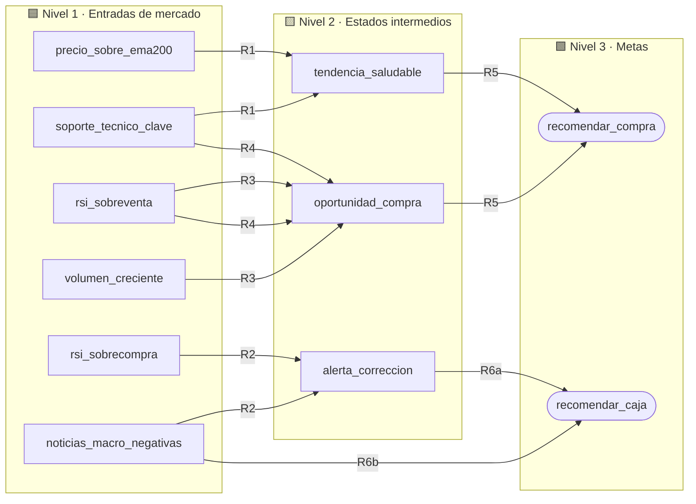

<div align="center">

# 📈 CryptoRisk & Trend SBC

### Sistema Basado en Conocimiento para la evaluación de riesgo y decisiones de *swing trading* en criptomonedas


*Cláusulas de Horn · Encadenamiento hacia adelante y hacia atrás · Explicabilidad · `YES` / `NO` / `UNKNOWN`*

</div>

---

## 📚 Tabla de contenido

1. [Descripción general](#-descripción-general)
2. [Dominio y justificación](#-dominio-y-justificación)
3. [Arquitectura del conocimiento](#-arquitectura-del-conocimiento)
4. [Base de conocimiento](#-base-de-conocimiento)
5. [Lógica trivalente e incertidumbre](#-lógica-trivalente-e-incertidumbre)
6. [Motores de inferencia](#-motores-de-inferencia)
7. [Escenarios de prueba](#-escenarios-de-prueba)
8. [Explicabilidad](#-explicabilidad-explain)
9. [Estructura del repositorio](#-estructura-del-repositorio)
10. [Cómo ejecutarlo](#-cómo-ejecutarlo)
11. [Entregables](#-entregables)
12. [Limitaciones y trabajo futuro](#-limitaciones-y-trabajo-futuro)
13. [Aviso legal](#-aviso-legal)

---

## 🎯 Descripción general

**CryptoRisk & Trend SBC** es un asistente inteligente que apoya la toma de decisiones de inversión en **criptomonedas y activos digitales** bajo la estrategia de *swing trading*. A partir de datos de mercado (tendencia, RSI, volumen, soportes y noticias macroeconómicas), el sistema **razona con reglas lógicas** hasta concluir una de dos recomendaciones:

| Recomendación | Significado |
| :--- | :--- |
| 🟢 `recomendar_compra` | Abrir posición de compra (riesgo moderado/bajo) |
| 🔴 `recomendar_caja` | Mantener liquidez y evitar operar (alto riesgo) |

El proyecto se construye sobre el motor de inferencia desarrollado en el laboratorio (`TAtom`, `TRule`, `TKnowledgeBase`, `TFactBase`) y demuestra tres capacidades centrales de la **IA simbólica**:

- ⏩ **Forward chaining** — de los hechos hacia las conclusiones.
- ⏪ **Backward chaining** — desde una meta, preguntando solo lo necesario.
- 🔍 **Explicabilidad** — justificación paso a paso del *cómo* y el *por qué* de cada decisión.

---

## 🧭 Dominio y justificación

El análisis técnico y de riesgo en los mercados financieros opera bajo marcos **basados en reglas estrictas** que combinan indicadores de tendencia, impulso (como el RSI) y condiciones macroeconómicas. Esto lo hace un dominio ideal para un **Sistema Basado en Conocimiento (SBC)** con cláusulas de Horn:

- 🧱 **Estructura jerárquica natural:** datos crudos de mercado → estados financieros intermedios → recomendación final.
- ❓ **Manejo de incertidumbre:** un indicador puede no estar disponible. La lógica trivalente (`YES`, `NO`, `UNKNOWN`) permite que el motor busque **rutas alternativas de confirmación** o **pregunte al usuario** únicamente lo que necesita.
- 🪟 **Transparencia:** cada conclusión es trazable hasta los hechos que la originaron, algo clave en contextos financieros.

---

## 🏗️ Arquitectura del conocimiento

El conocimiento se organiza en **tres niveles lógicos**:



---

## 🧠 Base de conocimiento

### Proposiciones atómicas (`TAtom`)

El sistema define **11 átomos** (`symbol` + `meaning`):

| Símbolo (`symbol`) | Significado (`meaning`) | Nivel |
| :--- | :--- | :---: |
| `precio_sobre_ema200` | El precio actual está por encima de la media móvil de 200 periodos (tendencia alcista general) | 1️⃣ Entrada |
| `rsi_sobreventa` | El RSI está por debajo de 30 (zona de oportunidad) | 1️⃣ Entrada |
| `rsi_sobrecompra` | El RSI está por encima de 70 (zona de peligro / sobrevalorado) | 1️⃣ Entrada |
| `volumen_creciente` | El volumen de negociación de las últimas sesiones va en aumento | 1️⃣ Entrada |
| `soporte_tecnico_clave` | El precio ha rebotado en un soporte histórico importante | 1️⃣ Entrada |
| `noticias_macro_negativas` | Hay reportes macroeconómicos o noticias regulatorias adversas | 1️⃣ Entrada |
| `tendencia_saludable` | El mercado mantiene una estructura de precios favorable | 2️⃣ Intermedio |
| `alerta_correccion` | Hay indicios técnicos de que el activo puede retroceder | 2️⃣ Intermedio |
| `oportunidad_compra` | Las condiciones técnicas sugieren un buen punto de entrada | 2️⃣ Intermedio |
| `recomendar_compra` | **Recomendación:** abrir posición de compra (riesgo moderado/bajo) | 3️⃣ Meta |
| `recomendar_caja` | **Recomendación:** mantener liquidez / evitar operar (alto riesgo) | 3️⃣ Meta |

### Reglas lógicas (`TRule`)

Las reglas conectan antecedentes y consecuentes bajo la forma de **cláusulas de Horn**:

| Regla | Antecedentes | | Consecuente | Nota |
| :---: | :--- | :---: | :--- | :--- |
| **R1** | `precio_sobre_ema200 ∧ soporte_tecnico_clave` | ⇒ | `tendencia_saludable` | |
| **R2** | `rsi_sobrecompra ∧ noticias_macro_negativas` | ⇒ | `alerta_correccion` | |
| **R3** | `rsi_sobreventa ∧ volumen_creciente` | ⇒ | `oportunidad_compra` | 🥇 Vía primaria de compra |
| **R4** | `rsi_sobreventa ∧ soporte_tecnico_clave` | ⇒ | `oportunidad_compra` | 🥈 Vía de respaldo si el volumen es `UNKNOWN` |
| **R5** | `tendencia_saludable ∧ oportunidad_compra` | ⇒ | `recomendar_compra` | |
| **R6a** | `alerta_correccion` | ⇒ | `recomendar_caja` | |
| **R6b** | `noticias_macro_negativas` | ⇒ | `recomendar_caja` | |

> 💡 **Sobre R6:** una cláusula de Horn admite un único literal positivo y **no** disyunciones en el antecedente. Por eso `alerta_correccion ∨ noticias_macro_negativas ⇒ recomendar_caja` se representa como **dos reglas separadas** (R6a y R6b), lógicamente equivalentes.

---

## ❓ Lógica trivalente e incertidumbre

Cada hecho puede tomar uno de tres valores:

| Valor | Significado |
| :---: | :--- |
| ✅ `YES` | El hecho es verdadero |
| ❌ `NO` | El hecho es falso |
| ❔ `UNKNOWN` | Se desconoce (indicador no disponible o aún no consultado) |

**¿Por qué importa?** Si `volumen_creciente` es `UNKNOWN`, la regla **R3** no puede confirmarse. Gracias a **R4**, el motor tiene una **vía alternativa** (`rsi_sobreventa ∧ soporte_tecnico_clave`) para llegar a `oportunidad_compra` sin quedar bloqueado. Y si ninguna vía resuelve la duda, el motor **pregunta al usuario** (`ask`) solo por lo imprescindible.

---

## ⚙️ Motores de inferencia

| Motor | Dirección | Punto de partida | Comportamiento |
| :--- | :---: | :--- | :--- |
| ⏩ **Forward chaining** | Datos → Metas | Hechos iniciales (`source = user`) | Dispara reglas en **múltiples pasadas** hasta que no se puedan deducir más hechos |
| ⏪ **Backward chaining** | Meta → Datos | Meta (`is_target = recomendar_compra`) | Evalúa antecedentes **recursivamente** y usa `ask` solo para datos desconocidos |

---

## 🧪 Escenarios de prueba

Ambos escenarios se ejecutan y documentan en el Jupyter Notebook.

### 🐂 Escenario 1 — Mercado alcista (*Forward chaining*)

**Hechos iniciales** (`source = user`):

| Hecho | Valor |
| :--- | :---: |
| `precio_sobre_ema200` | ✅ `YES` |
| `soporte_tecnico_clave` | ✅ `YES` |
| `rsi_sobreventa` | ✅ `YES` |
| `volumen_creciente` | ✅ `YES` |

**Deducción esperada:**

```text
Pasada 1:  R1 → tendencia_saludable
           R3 → oportunidad_compra
Pasada 2:  R5 → recomendar_compra   🟢
```

### 🌫️ Escenario 2 — Incertidumbre y meta específica (*Backward chaining*)

Se parte de una **base de hechos vacía** y se consulta la meta `recomendar_compra`. El motor recorre las reglas de forma recursiva (R5 → R1 / R3 / R4) y **pregunta interactivamente** solo por los datos que desconoce, demostrando un flujo de trabajo **guiado por objetivos**.

---

## 🔍 Explicabilidad (`Explain`)

Usando el historial de orígenes guardado en la `TFactBase` (`source`), la función de explicación recorre la cadena de inferencia **desde la meta hasta los hechos iniciales** e imprime una estructura indentada que justifica el *cómo* y el *por qué* de la decisión.

Ejemplo ilustrativo de la salida esperada para el Escenario 1:

```text
recomendar_compra                      ← R5
├── tendencia_saludable                ← R1
│   ├── precio_sobre_ema200            ← user
│   └── soporte_tecnico_clave          ← user
└── oportunidad_compra                 ← R3
    ├── rsi_sobreventa                 ← user
    └── volumen_creciente              ← user
```

---

## 🗂️ Estructura del repositorio

> Ajusta los nombres a los de tu entrega.

```text
CryptoRisk-Trend-SBC/
├── 📓 CryptoRisk_SBC.ipynb     # Notebook: dominio, carga de KB y escenarios
├── 🧩 motor/                   # Motor del laboratorio (TAtom, TRule, TKnowledgeBase, TFactBase)
├── 🖼️ presentacion/            # Diapositivas (PowerPoint / Canva)
└── 📄 README.md
```

---

## 🚀 Cómo ejecutarlo

### Requisitos

- Python 3.x
- Jupyter Notebook o JupyterLab
- El motor de inferencia desarrollado en el laboratorio

### Pasos

```bash
# 1. Clona el repositorio
git clone <URL-DEL-REPOSITORIO>
cd CryptoRisk-Trend-SBC

# 2. (Opcional) Crea un entorno virtual
python -m venv .venv
source .venv/bin/activate        # En Windows: .venv\Scripts\activate

# 3. Instala Jupyter
pip install jupyterlab

# 4. Abre el notebook
jupyter lab CryptoRisk_SBC.ipynb
```

### Subsistema de desarrollo (carga de la KB)

El notebook inicializa la `TKnowledgeBase` en este orden:

1. Registra primero los **11 átomos** (`TAtom`).
2. Agrega después las reglas **R1 a R6** (`TRule`).
3. Valida de forma estricta que **ningún antecedente o consecuente** se use sin estar previamente registrado.

Esquema ilustrativo (adáptalo a la API exacta de tu laboratorio):

```python
kb = TKnowledgeBase()

# 1) Átomos
kb.add_atom(TAtom("precio_sobre_ema200", "El precio está por encima de la EMA de 200 periodos"))
# ... resto de átomos ...

# 2) Reglas
kb.add_rule(TRule(["precio_sobre_ema200", "soporte_tecnico_clave"], "tendencia_saludable"))
# ... R2 a R6b ...
```

---

## 📦 Entregables

| Entregable | Contenido |
| :--- | :--- |
| 📓 **Jupyter Notebook** | Importación de clases, definición formal del dominio, carga de la KB y ejecución documentada de los escenarios *Forward* y *Backward* |
| 🎤 **Presentación** | 1. Introducción y descripción del dominio financiero · 2. Modelado formal (átomos y reglas de Horn) · 3. Demostración de los motores y del estado `UNKNOWN` · 4. Ejemplo de explicabilidad · 5. Conclusiones y ventajas de la IA simbólica en finanzas |

---

## 🔭 Limitaciones y trabajo futuro

- ⚖️ **Posible conflicto de metas:** con las reglas actuales, `recomendar_compra` y `recomendar_caja` podrían derivarse a la vez (por ejemplo, con noticias macro negativas y condiciones técnicas favorables). Una mejora natural es definir una **política de prioridad**, otorgando precedencia a `recomendar_caja` por ser la opción conservadora.
- 🎚️ **Umbrales fijos:** el RSI usa los umbrales clásicos 30/70; podrían parametrizarse según el activo.
- 🔢 **Sin grados de certeza:** la lógica trivalente no pondera la confianza; se podría extender con factores de certeza o lógica difusa.
- 🧬 **Más indicadores:** MACD, bandas de Bollinger o métricas on-chain ampliarían la base de conocimiento.

---

## ⚠️ Aviso legal

Este proyecto tiene **fines estrictamente académicos y educativos**. Sus recomendaciones **no constituyen asesoría financiera** ni invitación a invertir. Operar con criptomonedas implica un alto riesgo de pérdida de capital.

---

<div align="center">

**Hecho con 🧠 lógica, reglas de Horn y mucho ☕**

*CryptoRisk & Trend SBC · Proyecto de laboratorio · IA Simbólica*

</div>
